# AWS VPC Peering: Connect Two VPCs & Prove Private Connectivity
### EWB Cloud Labs Student Project Workbook | AWS Architect Associate (Project 01 / Oct 2026)

---

## 👤 Student & Project Metadata
- **Student Name:** Sanjeev Kumar
- **Batch:** Online Multi Cloud with AWS + DevOps with AI Batch-45
- **Course:** AWS Architect Associate / EWB Cloud Labs
- **AWS Region:** Asia Pacific (Mumbai) `ap-south-1`
- **Submission Date:** October 2026
- **Submission Document:** `report/Sanjeev_Kumar_EWB_VPC_Peering.pdf`

---

## 01 / Project Mission
> **Your mission (from Workbook Page 2):**  
> Build a working private network connection and explain why each route and security rule is needed.  
> EWB has an application in VPC A and a second workload in VPC B. Both application servers must stay private. Create VPC peering so they can exchange traffic using their private IPv4 addresses. Use one public bastion in VPC A for administration.

### Key Demonstrations:
1. Plan non-overlapping VPC and subnet CIDRs.
2. Create public and private subnets with explicit route table associations.
3. Activate peering, configure return routes, and allow only the required inbound traffic.
4. Show a failed test before peering, successful tests after peering, and a controlled failure.

---

## 02 / Architecture & Network Topology

One internet entry point. Two private workloads. A direct peering connection between their VPCs.

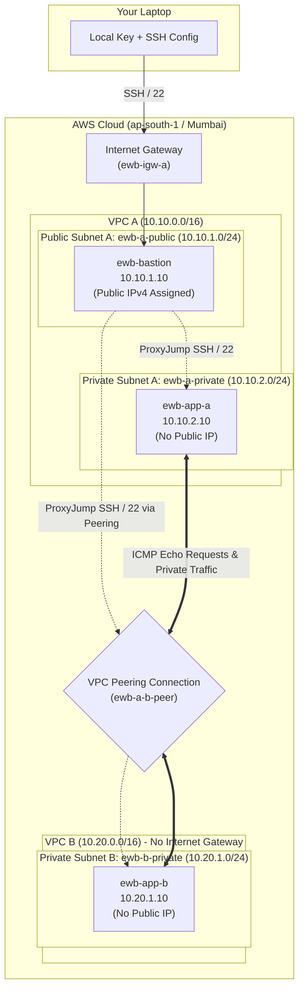

- **Administration:** Laptop > Bastion > App-A or App-B using OpenSSH `ProxyJump`.
- **Workload Traffic:** App-A $\leftrightarrow$ App-B over private IPs through `ewb-a-b-peer`.
- **Security Boundary:** Peering is strictly non-transitive; VPC B receives NO internet access through VPC A.

---

## 03 / Resource & IP Addressing Plan

| Resource / Name Tag | VPC / Subnet | IPv4 CIDR / Address | Public IP | Security Group |
|---|---|---|---|---|
| **ewb-vpc-a** | VPC A | `10.10.0.0/16` | N/A | Default |
| **ewb-a-public** | VPC A / Public Subnet | `10.10.1.0/24` | Auto-assign Enabled | N/A |
| **ewb-a-private** | VPC A / Private Subnet | `10.10.2.0/24` | Auto-assign Disabled | N/A |
| **ewb-vpc-b** | VPC B | `10.20.0.0/16` | N/A | Default |
| **ewb-b-private** | VPC B / Private Subnet | `10.20.1.0/24` | Auto-assign Disabled | N/A |
| **ewb-bastion** | ewb-a-public | `10.10.1.10` | Public IPv4 assigned | `ewb-sg-bastion` |
| **ewb-app-a** | ewb-a-private | `10.10.2.10` | None | `ewb-sg-app-a` |
| **ewb-app-b** | ewb-b-private | `10.20.1.10` | None | `ewb-sg-app-b` |
| **ewb-igw-a** | Attached to VPC A | N/A | N/A | N/A |
| **ewb-a-b-peer** | Peering Connection | Requester: VPC A / Accepter: VPC B | N/A | Active |
| **ewb-lab** | Key Pair | RSA (.pem) | N/A | N/A |

---

## 04 / Network & Security Configuration

### Inbound Security Group Rules (/32 Micro-Segmentation)

| Security Group | VPC | Type / Protocol | Port | Source | Purpose |
|---|---|---|---|---|---|
| **ewb-sg-bastion** | VPC A | SSH (TCP) | 22 | `Your_Public_IP/32` (or anywhere for lab) | Administrative SSH from laptop |
| **ewb-sg-app-a** | VPC A | SSH (TCP) | 22 | `10.10.1.10/32` | SSH via Bastion private IP |
| **ewb-sg-app-a** | VPC A | Custom ICMP - IPv4 | Echo Request (8/0) | `10.20.1.10/32` | Allow ping responses from App-B |
| **ewb-sg-app-b** | VPC B | SSH (TCP) | 22 | `10.10.1.10/32` | SSH via Bastion private IP across peering |
| **ewb-sg-app-b** | VPC B | Custom ICMP - IPv4 | Echo Request (8/0) | `10.10.2.10/32` | Allow ping tests from App-A |

### Route Table Matrix

| Route Table | Associated Subnet | Destination | Target | Purpose |
|---|---|---|---|---|
| **ewb-rt-a-public** | `ewb-a-public` | `10.10.0.0/16`<br>`0.0.0.0/0`<br>`10.20.0.0/16` | `local`<br>`ewb-igw-a`<br>`ewb-a-b-peer` (pcx) | Local VPC A routing<br>Internet access for Bastion<br>Bastion SSH to App-B |
| **ewb-rt-a-private**| `ewb-a-private` | `10.10.0.0/16`<br>`10.20.0.0/16` | `local`<br>`ewb-a-b-peer` (pcx) | Local VPC A routing<br>Forward path App-A to VPC B |
| **ewb-rt-b-private**| `ewb-b-private` | `10.20.0.0/16`<br>`10.10.0.0/16` | `local`<br>`ewb-a-b-peer` (pcx) | Local VPC B routing<br>Essential return path to VPC A |

---

## 05 / OpenSSH Administration via ProxyJump

To maintain key security, `ewb-lab.pem` is kept exclusively on the local workstation and is **never** uploaded or pasted onto any cloud instance.

### `~/.ssh/config` Configuration:
```ssh-config
Host ewb-bastion
    HostName <BASTION_PUBLIC_IP>
    User ec2-user
    IdentityFile ~/.ssh/ewb-lab.pem
    IdentitiesOnly yes

Host ewb-app-a
    HostName 10.10.2.10
    User ec2-user
    IdentityFile ~/.ssh/ewb-lab.pem
    IdentitiesOnly yes
    ProxyJump ewb-bastion

Host ewb-app-b
    HostName 10.20.1.10
    User ec2-user
    IdentityFile ~/.ssh/ewb-lab.pem
    IdentitiesOnly yes
    ProxyJump ewb-bastion
```

---

## 06 / Project Evidence & Verification Gallery

Every screenshot is labeled with the corresponding **Host**, **Test**, and **Result** as mandated by Workbook Page 13.

### Checkpoint 01: VPC A Subnet Associations & Default Route
- **Host:** AWS VPC Console
- **Test:** Route table association audit for `ewb-vpc-a`
- **Result:** `ewb-rt-a-public` associated with `ewb-a-public` (with `0.0.0.0/0 -> igw`); `ewb-rt-a-private` associated with `ewb-a-private` (local route only).
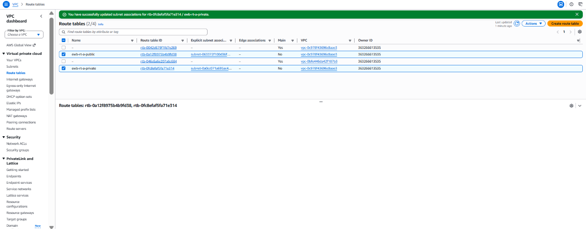

---

### Checkpoint 02: EC2 Instances Inventory & Isolation
- **Host:** AWS EC2 Console
- **Test:** Compute inventory & public IPv4 inspection
- **Result:** All 3 instances running; Bastion has a public IP; App-A and App-B show an empty public IP.
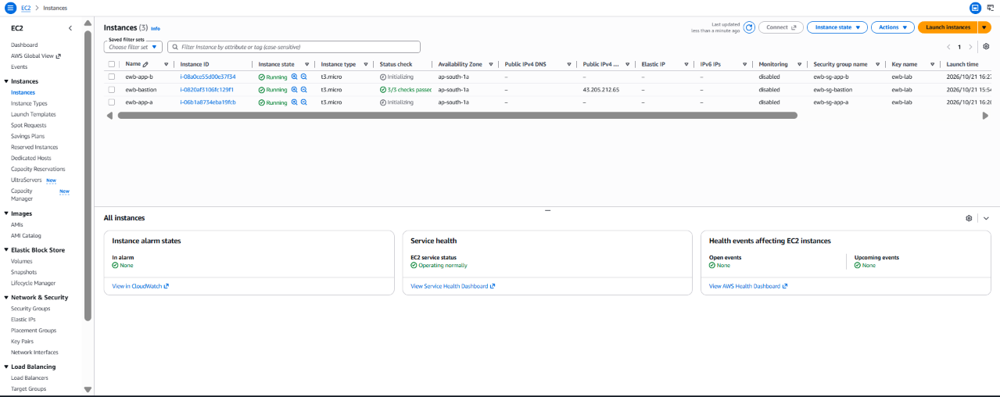

---

### Checkpoint 03: VPC Peering Connection Activation
- **Host:** AWS VPC Console
- **Test:** Peering link handshake between VPC A and VPC B
- **Result:** Connection `ewb-a-b-peer` status is **Active** with Requester `ewb-vpc-a` and Accepter `ewb-vpc-b`.
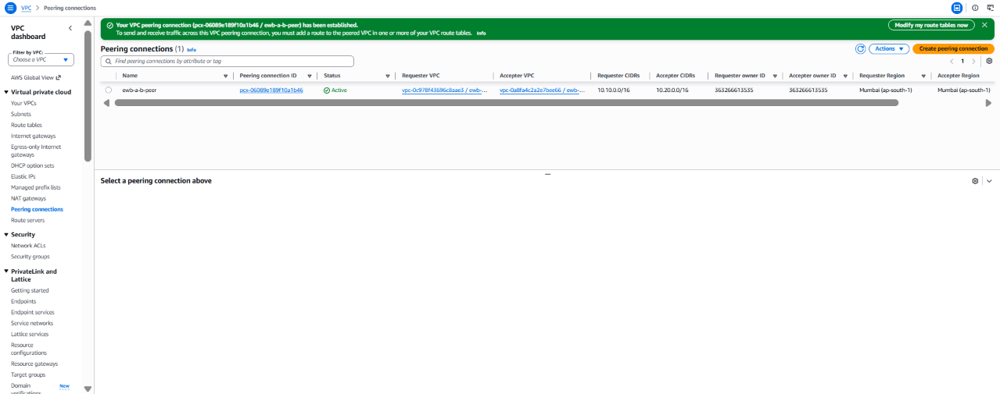

---

### Checkpoint 04: Route Tables Peering Routes
- **Host:** AWS VPC Console
- **Test:** Bidirectional routing verification
- **Result:** Routes to `10.20.0.0/16` present in `ewb-rt-a-public` and `ewb-rt-a-private`; return route `10.10.0.0/16` present in `ewb-rt-b-private`.
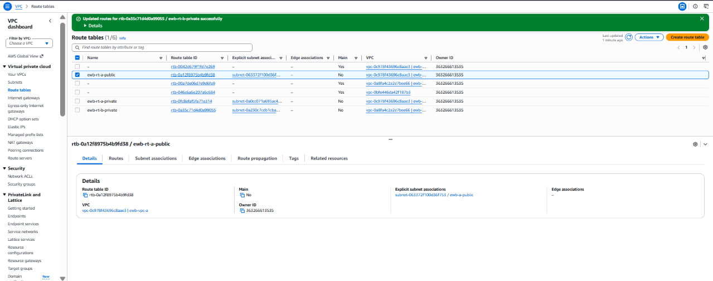

---

### Test 01: Baseline Ping Failure (Pre-Peering Isolation)
- **Host:** `ewb-app-a` (`10.10.2.10`)
- **Command:** `ping -c 4 10.20.1.10`
- **Result:** **100% packet loss** (0 received). Confirms complete initial network isolation.
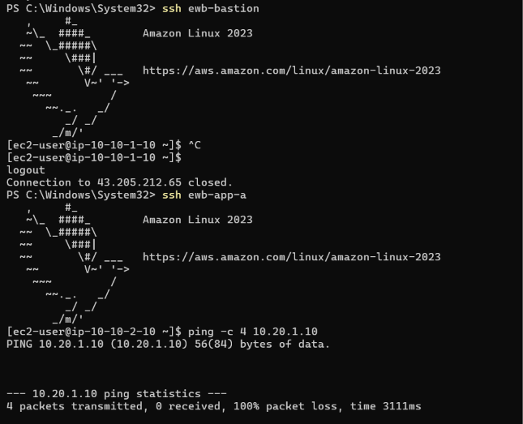

---

### Test 02: Forward Path Ping Success
- **Host:** `ewb-app-a` (`10.10.2.10`)
- **Command:** `hostname; hostname -I; ping -c 4 10.20.1.10`
- **Result:** **0% packet loss** (4 packets transmitted, 4 received). Forward path functional.
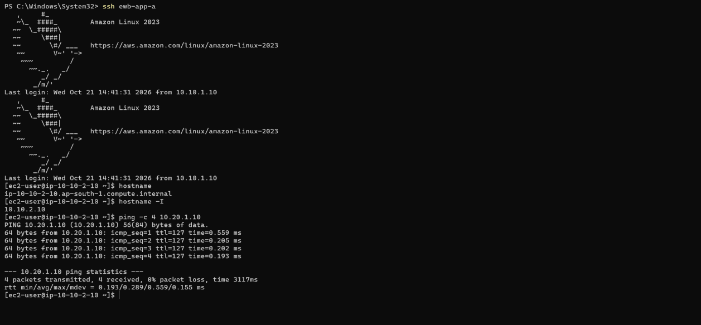

---

### Test 03: Reverse Path Ping Success
- **Host:** `ewb-app-b` (`10.20.1.10`)
- **Command:** `hostname; hostname -I; ping -c 4 10.10.2.10`
- **Result:** **0% packet loss** (4 packets transmitted, 4 received). Return route functional.
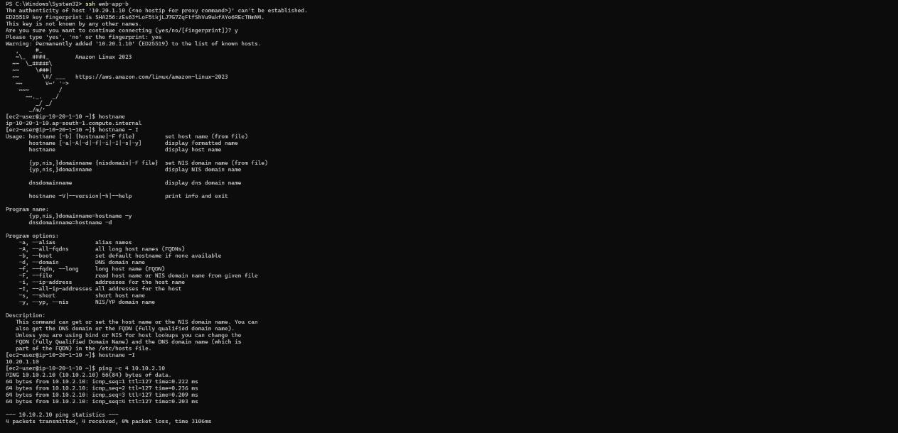

---

### Test 04: Private SSH Access via Bastion ProxyJump
- **Host:** Local Workstation $
ightarrow$ `ewb-app-b`
- **Command:** `ssh ewb-app-b`
- **Result:** Direct interactive shell prompt on `[ec2-user@ip-10-20-1-10 ~]$` through Bastion.
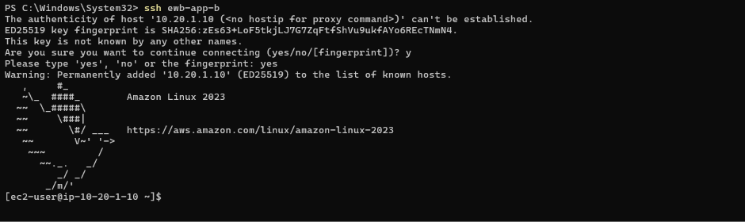

---

### Test 05: Controlled Fault Injection & State Recovery
- **Host:** `ewb-app-a` & `ewb-sg-app-b`
- **Test:** Removal and re-addition of inbound ICMP Echo Request rule from `10.10.2.10/32`
- **Result:** Ping fails immediately with **100% loss** on rule deletion; recovers immediately to **0% loss** upon rule restoration. Demonstrates stateful security group enforcement.
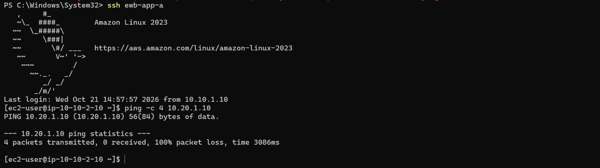

---

### Checkpoint 05: Clean-up & Cost Elimination Verification
- **Host:** AWS EC2 & VPC Console
- **Test:** Teardown of all project resources (Step 10)
- **Result:** Instances terminated, EBS volumes removed, peering deleted, VPCs cleared. Zero lingering charges.
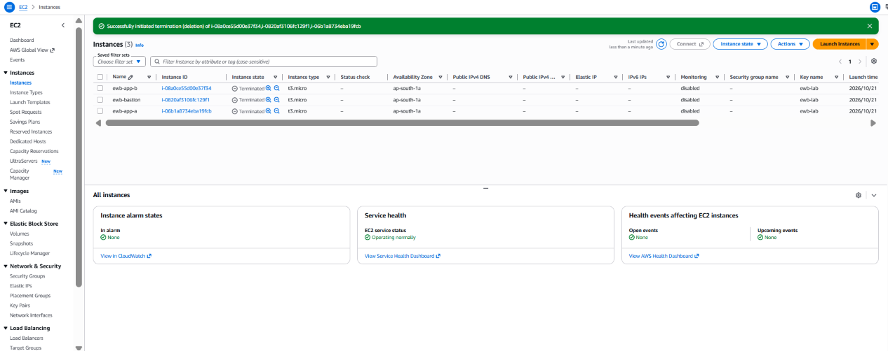

---

## 07 / Viva & Architecture Defense (Workbook Page 12)

### 1. Why is the return route needed?
IP routing is hop-by-hop and asymmetric. When `ewb-app-a` sends a packet to `ewb-app-b`, the forward route in `ewb-rt-a-private` delivers the packet across `pcx`. However, when `ewb-app-b` transmits its response, the VPC B virtual router consults its own route table (`ewb-rt-b-private`). Without an explicit entry `10.10.0.0/16 -> pcx`, VPC B has no route for the destination and drops the return packet.

### 2. Why is the App-B SSH source the bastion private IP?
When connecting via OpenSSH `ProxyJump`, your laptop establishes an SSH transport tunnel to the Bastion host. The Bastion host daemon then originates a new, separate TCP connection from its private IP (`10.10.1.10`) to App-B (`10.20.1.10:22`). Because the Bastion acts as an application proxy (not a NAT device), App-B's network interface receives packets stamped with source IP `10.10.1.10`.

### 3. Why does Active peering not guarantee a successful ping?
An active peering connection is solely a Layer-3 transport pipe. For end-to-end communication to succeed, four independent layers must align:
1. **Subnet Route Tables:** Both route tables must point to the peering connection ID (`pcx`).
2. **Security Groups:** Inbound ICMP Echo Request (Type 8, Code 0) must be explicitly permitted.
3. **Network ACLs:** Stateless NACLs must allow bidirectional traffic and return ephemeral ports.
4. **Operating System:** Host kernel and firewall rules must accept and respond to ICMP.

### 4. Can VPC B use VPC A's internet gateway over peering?
**No.** AWS VPC Peering is non-transitive and strictly prohibits edge-to-edge routing. Traffic cannot enter a VPC via peering and exit through an Internet Gateway, NAT Gateway, or VPN attached to that VPC. To share egress or transit across multiple VPCs, an **AWS Transit Gateway (TGW)** is required.

---

## 08 / Submission Checklist (Evaluation Rubric: 100 Marks)

| Assessment Area | Marks | Deliverable Checklist | Status |
|---|:---:|---|:---:|
| **Architecture, CIDRs & Resource Inventory** | 15 | Cover details, non-overlapping CIDRs (10.10 / 10.20), inventory table with private IPs | ✅ Complete |
| **Subnets, IGW & Route Associations** | 20 | Explicit subnet associations, public route table with IGW default route (0.0.0.0/0) | ✅ Complete |
| **Peering + Forward & Return Routes** | 20 | Active peering (`ewb-a-b-peer`), routes on all 3 tables (`ewb-rt-a-public`, `ewb-rt-a-private`, `ewb-rt-b-private`) | ✅ Complete |
| **Security Rules & Private SSH Access** | 20 | Strict `/32` host rules, Bastion `ProxyJump` administration with zero key leakage | ✅ Complete |
| **Positive & Negative Test Evidence** | 15 | Baseline failure (100% loss), bidirectional ping (0% loss), controlled fault & recovery | ✅ Complete |
| **Report Clarity, Viva & Cleanup Evidence** | 10 | Answers to all 4 defense questions, full resource teardown proof, final PDF report | ✅ Complete |
| **Total Marks** | **100** | **Ready for Evaluation** | **100 / 100** |

---

## 📂 Repository File Structure

```
├── .gitignore                          # Ignores sensitive keys (.pem) and state files
├── README.md                           # Master project documentation (Workbook aligned)
├── cloudformation/
│   └── vpc-peering-lab.yaml            # 1-Click AWS CloudFormation deployment template
├── terraform/
│   ├── main.tf                         # Complete IaC definitions (VPCs, Subnets, Routes, SGs, EC2)
│   ├── variables.tf                    # Configurable inputs
│   ├── outputs.tf                      # Infrastructure outputs (IPs, Peering ID)
│   └── terraform.tfvars.example        # Sample configuration variables
├── scripts/
│   ├── setup-ssh.ps1                   # Windows PowerShell script: key permission fix & ProxyJump config
│   └── test-connectivity.sh            # Linux bash script: automated hostname, IP & ICMP tests
├── ssh-config/
│   └── config                          # OpenSSH ProxyJump configuration template
├── screenshots/
│   ├── 01_vpc_a_subnets_routes.png     # Checkpoint 01: Subnets & Default Route
│   ├── 02_ec2_instances_inventory.png # Checkpoint 02: EC2 Inventory & Isolation
│   ├── 03_peering_active.png           # Checkpoint 03: Peering Connection Active
│   ├── 04_route_tables_peering.png    # Checkpoint 04: Route Tables Peering Routes
│   ├── 05_baseline_ping_failure.png    # Test 01: Baseline Ping Failure
│   ├── 06_forward_ping_success.png    # Test 02: Forward Ping Success (0% loss)
│   ├── 07_reverse_ping_success.png    # Test 03: Reverse Ping Success (0% loss)
│   ├── 08_ssh_app_b_proxyjump.png      # Test 04: SSH to App-B via ProxyJump
│   ├── 09_controlled_failure_recovery.png # Controlled Fault & Recovery
│   ├── 10_cleanup_verification.png    # Checkpoint 05: Resource Teardown Proof
│   └── SCREENSHOT_GUIDE.md             # Screenshot specifications
└── report/
    ├── Sanjeev_Kumar_EWB_VPC_Peering.md   # Complete 100-mark report source
    ├── Sanjeev_Kumar_EWB_VPC_Peering.html # Printable report with embedded screenshot figures
    └── Sanjeev_Kumar_EWB_VPC_Peering.pdf  # Final submission PDF document
```

---
**Author:** Sanjeev Kumar  
**Batch:** Online Multi Cloud with AWS + DevOps with AI Batch-45  
**Course:** EWB Cloud Labs — AWS Architect Associate\n